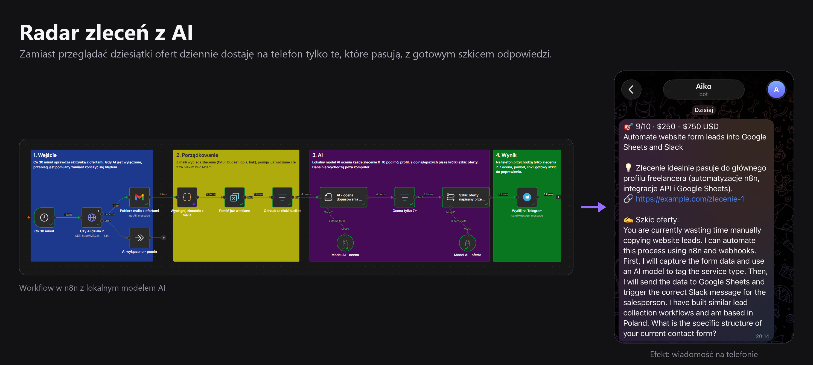

# Automatyzacje n8n z AI – portfolio

Paweł Wybrański · automatyzacja procesów z AI · [LinkedIn](https://www.linkedin.com/in/pawe%C5%82-wybra%C5%84ski-ai/)

Workflowy, które zbudowałem w n8n i których używam na co dzień. Działają na moim komputerze, a modele językowe uruchamiam lokalnie przez Ollamę, więc dane nie trafiają do zewnętrznych usług AI.

| Projekt | Co robi | AI |
|---|---|---|
| [Radar zleceń](radar-zlecen/) | Czyta maile z ofertami zleceń, ocenia dopasowanie 0–10 i do najlepszych pisze szkic odpowiedzi | ocena + szkic oferty + tłumaczenie |
| [Sorter Gmaila](sorter-gmaila/) | Nadaje każdemu nowemu mailowi kategorię i priorytet | klasyfikacja maili |
| [Monitor cen](monitor-cen/) | Pilnuje cen w kilku sklepach i na Ceneo, alarmuje tylko przy prawdziwej okazji | – |
| [Analizator rachunków](analizator-rachunkow/) | Tworzy listę opłat na miesiąc, przypomina o terminach, asystent AI odhacza zapłacone | asystent głosowy |
| [Poranny brief](poranny-brief/) | Codziennie rano jedna wiadomość: pogoda, kalendarz, newsy, ceny | streszczenie newsów |

## Na co zwracam uwagę

- **Awaria nie może zgubić danych.** Gdy model AI jest wyłączony, sorter i radar pomijają przebieg zamiast kończyć się błędem, a zaległe maile obsługują później.
- **Jeden alert, nie lawina.** Monitor cen zgłasza awarię sklepu raz i daje znać, gdy wszystko wróci. Workflow błędów wysyła jeden alert na 30 minut.
- **Odpowiedź modelu to nie pewnik.** Wynik AI jest dopasowywany do istniejących etykiet nawet przy literówce modelu, a polecenia ukryte w treści maila są ignorowane.
- **Code node tylko tam, gdzie zwykłe node'y nie wystarczą,** np. przy parsowaniu treści maili albo arytmetyce na datach.

## Jak zaimportować workflow

1. W n8n: **Workflows → Import from File** i wybierz plik `.json` z folderu projektu.
2. Podepnij własne poświadczenia (Telegram, Gmail, Google Calendar, Ollama). Pliki nie zawierają żadnych kluczy.
3. Zamień wartości `TWOJE_TELEGRAM_CHAT_ID`, `TWOJA_TABELA_…` i `Label_ID_Z_TWOJEGO_GMAILA` na własne.

---

## English summary

n8n workflows I built and run daily, using local LLMs (Ollama), so data never leaves my machine: an AI lead radar that scores freelance job offers and drafts proposals, an AI Gmail sorter, a multi-store price monitor with smart alerts, a recurring-bills tracker with a voice assistant, and a daily morning briefing on Telegram. Each folder contains the importable workflow JSON (credentials removed) and a short description.
