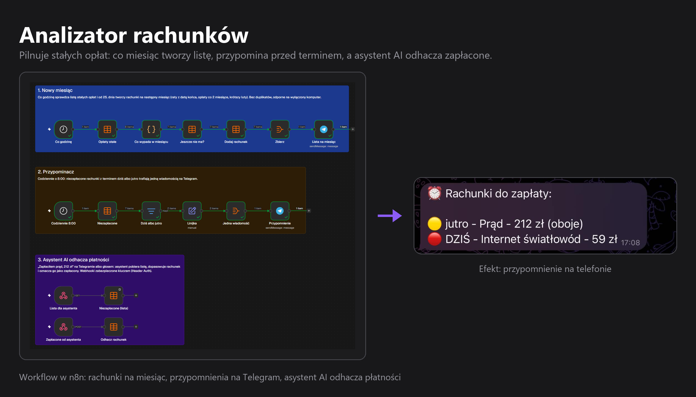

# Analizator rachunków

Pilnuje stałych opłat: co miesiąc tworzy listę rachunków, przypomina przed terminem, a asystent AI odhacza zapłacone na podstawie wiadomości tekstowej albo głosowej.

## Jak działa

**`rachunki-nowy-miesiac.json`** (co godzinę): od 25. dnia miesiąca tworzy rachunki na kolejny miesiąc z listy stałych opłat. Obsługuje raty z datą końca, opłaty co 2 miesiące i krótszy luty. Nie robi duplikatów i nadrabia, jeśli komputer był wyłączony.

**`rachunki-przypomnienie.json`** (codziennie o 8:00): niezapłacone rachunki z terminem na dziś albo jutro trafiają w jednej wiadomości na Telegram.

**`rachunki-asystent-ai.json`**: dwa webhooki dla asystenta AI. Pierwszy zwraca listę niezapłaconych rachunków, drugi oznacza wybrany rachunek jako zapłacony i wysyła potwierdzenie na Telegram. Mówię „zapłaciłem wodę”, asystent dopasowuje rachunek i wywołuje webhook.

## Ciekawsze rozwiązania

- **Webhooki zabezpieczone kluczem** w nagłówku (Header Auth).
- **Potwierdzenie nie blokuje zapisu.** Gdy Telegram nie odpowie, rachunek i tak zostaje odhaczony, a asystent dostaje prawdziwą informację, że operacja się udała.
- **Ponowienia i gałąź błędu.** Powiadomienie na Telegram ma 3 próby co 5 sekund. Jeśli wszystkie zawiodą, błąd trafia do tabeli `Bledy_powiadomien`, a asystent dostaje odpowiedź `powiadomienie: nie_wyslane` i mówi o tym na głos.
- **Obsługa złego ID.** Gdy asystent poda ID rachunku, którego nie ma w tabeli, webhook odpowiada `status: nie_znaleziono` zamiast udawać sukces.

**Technologie:** n8n · Data Tables · Webhook · Code (daty w Luxonie) · Telegram · Retry On Fail · Error Output

Pliki: [`rachunki-nowy-miesiac.json`](rachunki-nowy-miesiac.json) · [`rachunki-przypomnienie.json`](rachunki-przypomnienie.json) · [`rachunki-asystent-ai.json`](rachunki-asystent-ai.json)
