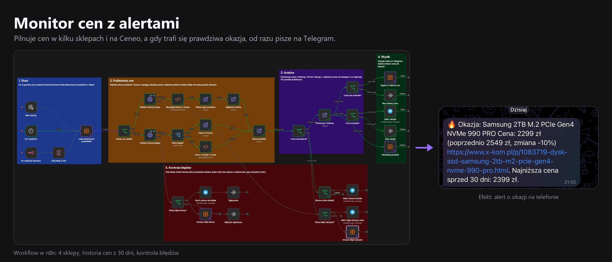

# Monitor cen z alertami

Pilnuje cen podzespołów w kilku sklepach i na Ceneo. Gdy trafi się prawdziwa okazja, od razu pisze na Telegram.

## Jak działa

**`monitor-cen.json`** (co 2 godziny i po restarcie serwera):
1. Bierze listę śledzonych produktów z tabeli.
2. Pobiera strony. Każdy sklep ma własny sposób odczytu ceny: meta tagi (Morele, x-kom), JSON-LD (Proline), lista ofert z nagłówkami przeglądarki (Ceneo, razem z najtańszym sklepem).
3. Porównuje cenę z historią. **Okazja** to cena o co najmniej 5% niższa od maksimum z 30 dni, niższa niż przy poprzednim sprawdzeniu i najniższa z 30 dni.
4. Każdą zmianę ceny zapisuje w historii.

**`min-max-cena-30-dni.json`** (raz dziennie) liczy minimum i maksimum z 30 dni. Uwzględnia też produkty, których cena się nie zmieniała, żeby minimum nie „zamarzło”.

**`alert-o-bledach.json`** to wspólny workflow błędów dla wszystkich automatyzacji. Wysyła jeden alert na 30 minut z liczbą pominiętych podobnych błędów.

## Kontrola błędów

- Gdy sklep zmieni stronę albo przestanie odpowiadać, dostaję **jeden** alert, a nie co 2 godziny. Stan awarii jest zapisany w tabeli.
- Gdy strona wróci, przychodzi wiadomość „znów działa”.
- Osobno wykrywam cichą awarię Ceneo: cena jest odczytana, ale lista ofert pusta.

**Technologie:** n8n · HTTP Request · HTML Extract · Data Tables · Telegram

Pliki: [`monitor-cen.json`](monitor-cen.json) · [`min-max-cena-30-dni.json`](min-max-cena-30-dni.json) · [`alert-o-bledach.json`](alert-o-bledach.json)
