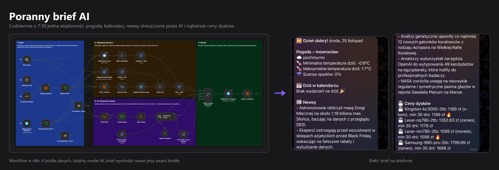

# Poranny brief AI

Codziennie o 7:30 jedna wiadomość na Telegramie: pogoda, plan dnia z kalendarza, najważniejsze newsy streszczone przez AI i najtańsze ceny z monitora cen.

## Jak działa

1. **Start:** codziennie o 7:30, po restarcie serwera albo na komendę „brief teraz” wysłaną na Telegramie. Dziennik w tabeli pilnuje, żeby brief przyszedł raz dziennie. Jeśli komputer był rano wyłączony, brief wyjdzie po jego włączeniu.
2. **Zbieranie danych, równolegle:** wydarzenia z Kalendarza Google, prognoza z API Open-Meteo (kody pogody zamienione na polskie opisy) i najtańsza oferta każdego dysku z bazy [monitora cen](../monitor-cen/).
3. **AI streszcza newsy:** lokalny model robi z 8 najnowszych artykułów RSS od 3 do 5 punktów.
4. **Wynik:** Merge łączy cztery gałęzie w jedną wiadomość HTML na Telegram.

## Odporność na awarie

Każde źródło może paść, a brief i tak wychodzi. Bez RSS w briefie pojawia się komunikat, bez modelu AI same nagłówki, a bez Kalendarza informacja o problemie z poświadczeniami.

**Technologie:** n8n · REST API · RSS · Basic LLM Chain · Ollama · Google Calendar · Data Tables · Telegram

Plik: [`poranny-brief.json`](poranny-brief.json)
