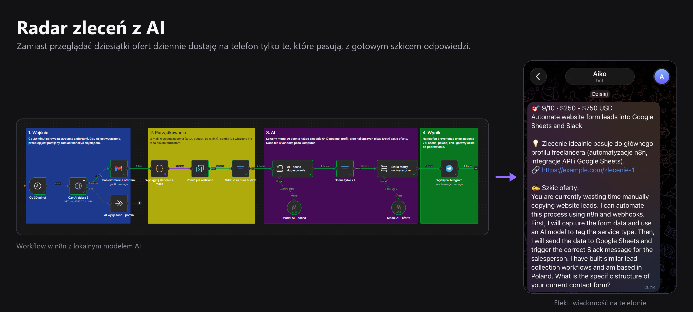

# Radar zleceń z AI

Zamiast codziennie przeglądać dziesiątki ofert na portalach dla freelancerów, dostaję na Telegram tylko te, które do mnie pasują, razem ze szkicem odpowiedzi.

## Jak działa

1. **Co 30 minut** sprawdza, czy lokalny model AI (Ollama) działa. Jeśli nie, przebieg kończy się po cichu, a maile czekają na kolejny.
2. **Pobiera maile z ofertami** (Freelancer.com, Useme) i rozbija je na pojedyncze zlecenia: tytuł, budżet, opis, link.
3. **Odsiewa** zlecenia już widziane i te z budżetem poniżej progu (przeliczanym na USD).
4. **AI ocenia dopasowanie** każdego zlecenia do mojego profilu w skali 0–10 i podaje powód oceny.
5. Do zleceń z oceną **7+** drugi model pisze **szkic oferty**, a trzeci tłumaczy go na polski, żebym wiedział, co wysyłam.
6. Wynik trafia na Telegram.

## Ciekawsze rozwiązania

- **Model nie może zmyślać.** Prompt szkicu zawiera listę faktów o mnie i zakaz wymyślania czegokolwiek spoza niej.
- **Wykrywanie zmiany formatu maila.** Jeśli przyszedł mail z ofertami, a parser nie znalazł w nim żadnego zlecenia, dostaję alarm (raz na mail), zamiast cichej awarii.
- **Code node tylko do parsowania** treści maili. Reszta to natywne node'y n8n (Remove Duplicates, Filter, Information Extractor).

**Technologie:** n8n · Ollama · Information Extractor · Basic LLM Chain · Gmail · Telegram

Plik: [`radar-zlecen.json`](radar-zlecen.json)
