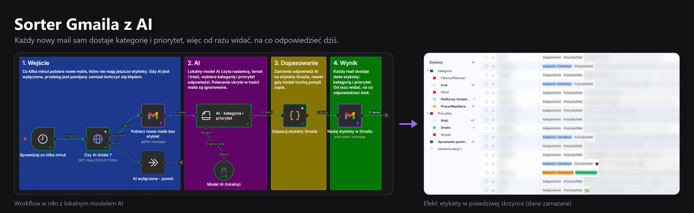

# Sorter Gmaila z AI

Każdy nowy mail sam dostaje kategorię i priorytet, więc od razu widać, na co trzeba odpowiedzieć dziś.

## Jak działa

1. **Co kilka minut** sprawdza, czy lokalny model AI działa. Jeśli nie, pomija przebieg bez błędu.
2. **Pobiera maile bez etykiet** z ostatnich dwóch dni. Dlatego nic nie przepada, nawet gdy komputer albo model był wyłączony. Zaległości obsłużą się przy następnym przebiegu.
3. **Lokalny model** czyta nadawcę, temat i treść, po czym wybiera kategorię (Klient, Faktury, Praca, Platformy zakupowe, Inne) i priorytet (Wysoki, Średni, Niski).
4. **Code node dopasowuje odpowiedź AI do etykiet Gmaila,** nawet gdy model trochę pomyli zapis (wielkość liter, polskie znaki, interpunkcja).
5. Mail dostaje dwie etykiety.

## Dlaczego przebudowałem go od zera

Pierwsza wersja używała Gmail Triggera. Gdy model był wyłączony, trigger i tak przesuwał znacznik „ostatnio sprawdzone”, więc maile z tego czasu nigdy nie dostawały etykiet. Obecna wersja nie zapamiętuje, co już widziała. Bierze po prostu wszystkie maile bez etykiet.

**Technologie:** n8n · Ollama · Information Extractor · Gmail API

Plik: [`sorter-gmaila.json`](sorter-gmaila.json)
